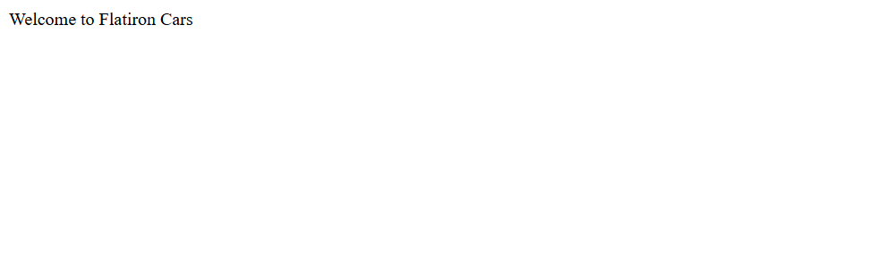

# Flatiron Cars

A small Flask application that introduces Flatiron Cars and looks up car models in its fleet.

## Routes

| Route | Response |
| --- | --- |
| `/` | `Welcome to Flatiron Cars` |
| `/<model>` | `Flatiron <model> is in our fleet!` when the model is recognized |
| `/<model>` | `No models called <model> exists in our catalog` when it is not recognized |

Recognized models are `Beedle`, `Crossroads`, `M2`, and `Panique`.

## Run locally

Install the dependencies from the project root:

```bash
python3 -m pip install Flask==2.2.2 Werkzeug==2.3.7
```

Start the application:

```bash
python3 server/app.py
```

Open [http://127.0.0.1:5000/](http://127.0.0.1:5000/) in a browser. Try a model at [http://127.0.0.1:5000/Beedle](http://127.0.0.1:5000/).

## Screenshot



## Tests

Run the provided route tests from the project root:

```bash
python3 -m pytest -q server/testing/app_test.py
```
